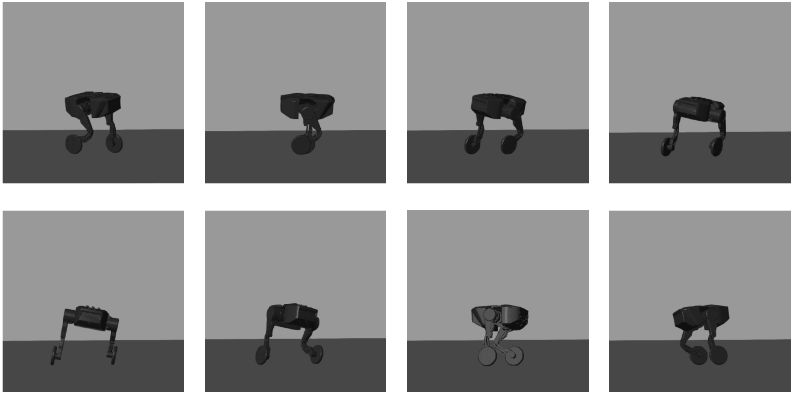
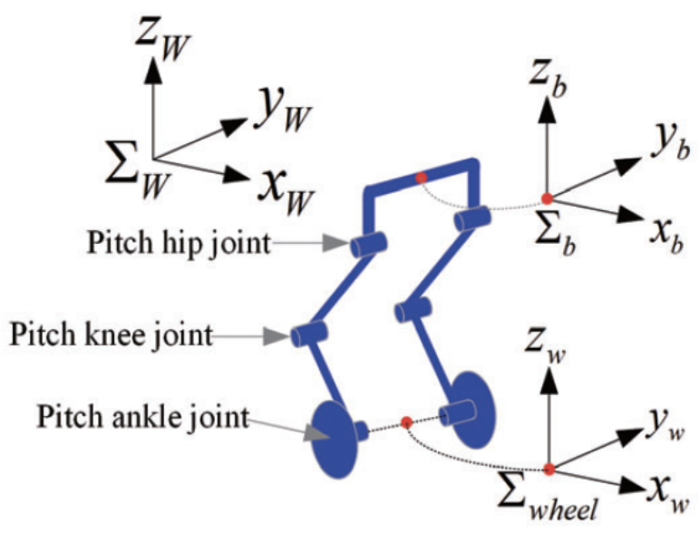
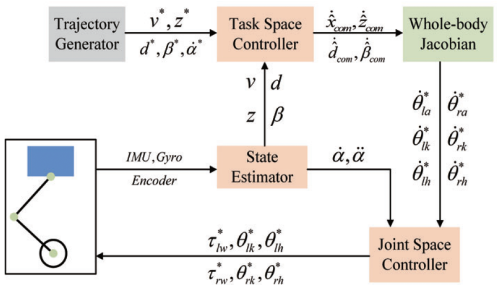
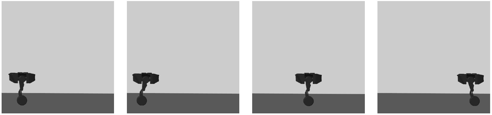
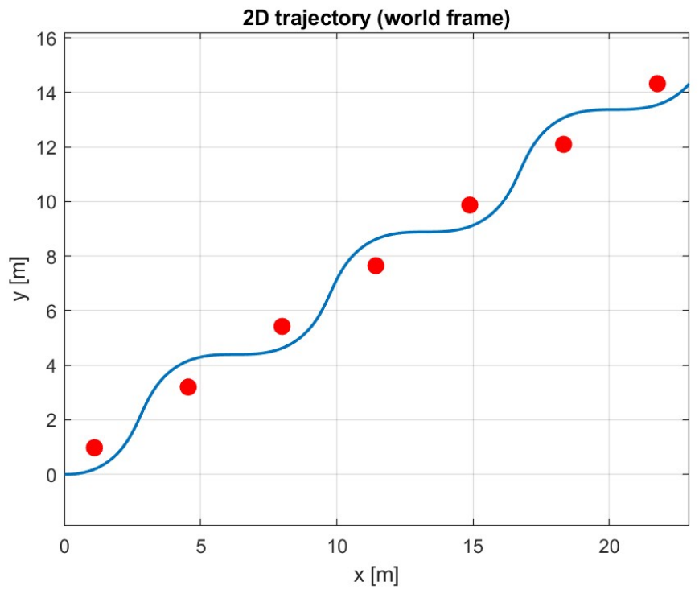
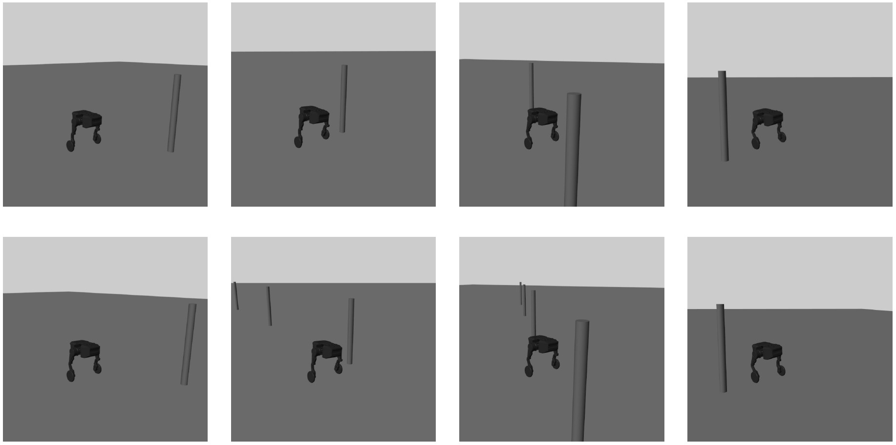

# Whole-body Motion Planning and Control for Underactuated Wheeled-Bipedal Robots

A whole-body motion planning and control framework for an underactuated wheeled-bipedal robot. It is implemented in MATLAB and visualized in Simulink.

<p align="center">
  
</p>

## Overview

A wheeled-bipedal robot touches the ground at only two wheel contact points, so the wheel motion and the torso posture are strongly coupled. The ankle actuator drives both the crus swing and the wheel, which makes the system **underactuated**.

The key idea is to turn the wheel-torque control problem into a **posture control problem**. Using a *Wheeled Inverted Pendulum Model* (WIPM), the CoM acceleration is set by the horizontal offset between the CoM and the wheel contact point:

$$\ddot{x}_c = \frac{g}{z_c}\,(x_c - x_p)$$

So the robot does not command wheel rotation directly. It plans the CoM posture, and the wheels follow.

<p align="center">
  
</p>

## Method

1. **Single-leg kinematics**: each leg is a planar chain (ankle, knee and hip pitch joints) modeled in the wheel frame. This gives the hip pose and the leg Jacobian.
2. **Whole-Body Jacobian (WBJ)**: the torso task $q_{com} = [x_{com},\ z_{com},\ d,\ \beta_{com}]$ (forward position, height, hip height difference for roll, pitch) and two posture constraints are mapped to the 6 leg joint velocities. The result is a square, full-rank, invertible $6\times6$ WBJ.
3. **Turning**: for a desired yaw rate $\dot\alpha$, the roll that balances the centrifugal acceleration is $\tan\gamma = v\dot\alpha / g$. It is obtained through the hip height difference $d = l_b \tan\gamma$.
4. **Control architecture** (hierarchical):
   - *Task-space PD*: tracks $v,\ z,\ d,\ \beta$ and outputs the desired torso velocities.
   - *WBJ inversion*: computes the desired joint velocities, which are integrated to get joint references.
   - *Joint-space control*: position control on the hips and knees. The ankle angle is tracked through **wheel torques**, plus a differential torque term for the yaw rate.

<p align="center">
  
</p>

## Simulations

The closed-loop system is integrated with `ode45`. The resulting trajectories are then replayed in Simulink on the robot model imported from the URDF. Three tasks are available:

**1. Velocity tracking**: sinusoidal forward velocity reference (±1.5 m/s).

<p align="center"></p>

**2. Velocity + yaw tracking**: constant 1.5 m/s with a yaw rate that ramps up to 1.5 rad/s (see the frames at the top).

**3. Slalom**: constant 1.5 m/s with a sinusoidal yaw rate, weaving between poles.

<p align="center">
  
</p>
<p align="center">
  
</p>

Videos of the three tasks are in [`video/`](video/).

## Repository structure

```
├── software .../                 # MATLAB / Simulink code
│   ├── main.m                    # parameters, gains, trajectories, ode45 loop, Simulink replay
│   ├── leg_fk.m                  # single wheeled-leg forward kinematics
│   ├── task_from_hips.m          # torso task variables from the two hip poses
│   ├── compute_WBJ.m             # Whole-Body Jacobian
│   ├── robot_sm_3.slx            # Simulink / Simscape Multibody model
│   ├── robot.urdf, meshes/       # robot description
├── video/                        # simulation videos (task_1/2/3.mp4)
├── ..._report.pdf                # full project report
└── ....pdf                       # presentation slides
```

## Usage

Requirements: MATLAB, Simulink, Simscape Multibody.

1. Open the software folder in MATLAB.
2. In `main.m`, choose the task: `task = 1` (velocity), `2` (velocity + yaw), `3` (slalom).
3. Run `main.m`. It simulates the system, plots the results and opens the Simulink visualization.

## Authors

Francesca Di Santo, Dario Finocchiaro, Arianna Navarra
Supervised by Prof. Giuseppe Oriolo and Francesco D'Orazio, Sapienza University of Rome (DIAG), A.Y. 2025/2026.

See the [report](<Whole-body Motion Planning and Control for underactuated_wheeled-bipedal_robots_report.pdf>) for the full derivation and results.
